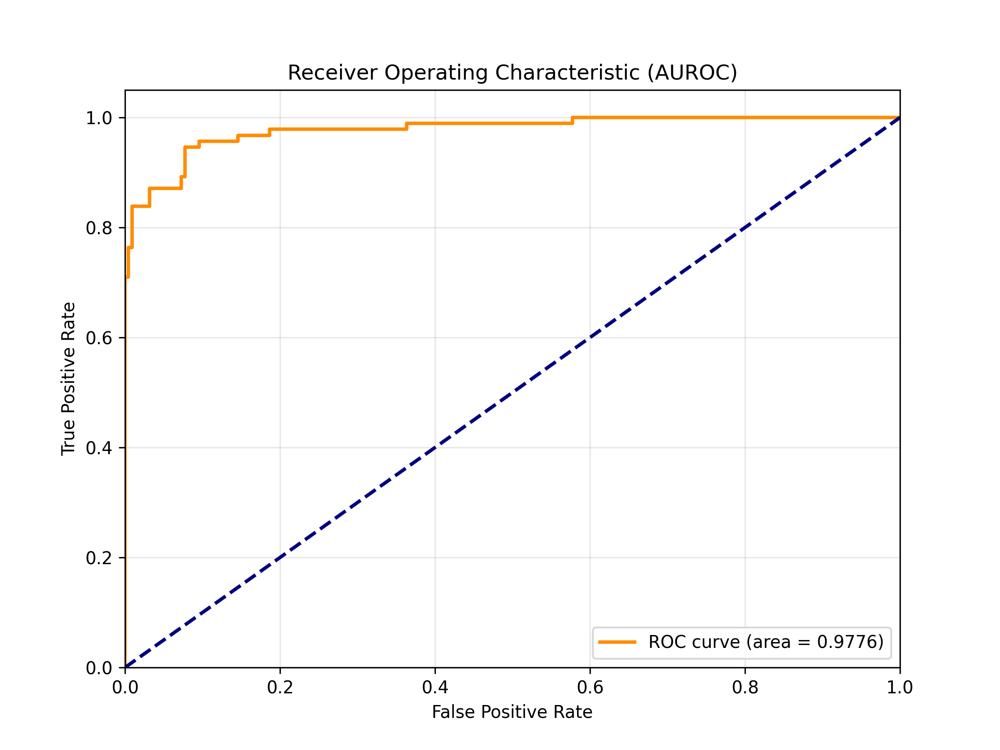
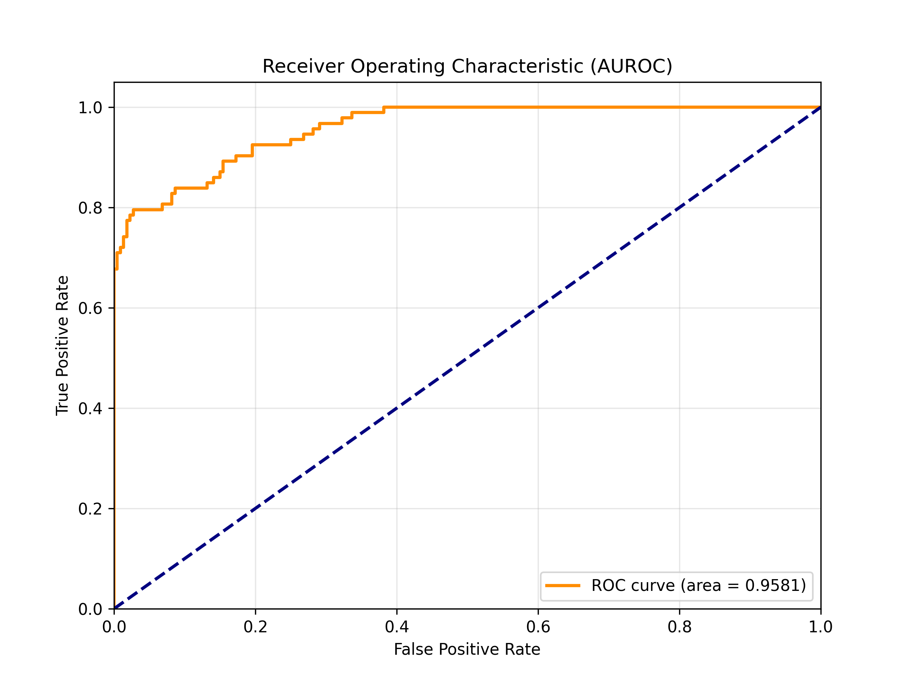
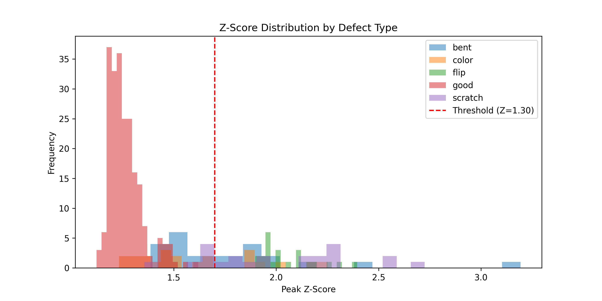
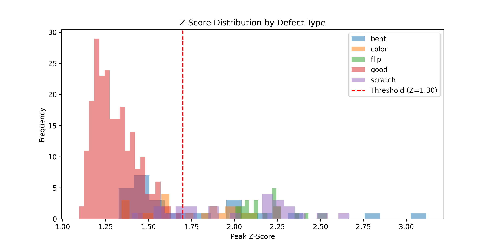

# MADDS — Modality-Agnostic Defect Detection System

Unsupervised industrial defect detection across Thermal (IR) and RGB images, using a frozen dual-branch architecture with cross-attention fusion and statistical anomaly scoring — no manual threshold calibration or model training required.

## Architecture

- **CNN Branch (Query):** Truncated EfficientNet-B0 extracts a 7×7 spatial feature map of local textures.
- **ViT Branch (Key/Value):** Frozen CLIP-ViT-B/16, patches pooled to 7×7, provides global structural context.
- **Cross-Attention Fusion:** `Attention = softmax(QK^T / √d)V` validates local anomalies against global structure to suppress false positives from normal object geometry.
- **Modality Router:** Auto-detects IR vs RGB input via HSV saturation analysis, and generates a synthetic proxy for whichever modality is missing (Gaussian blur + Canny + Jet colormap for RGB→IR; grayscale-to-3-channel for IR→RGB), guaranteeing 1:1 spatial alignment.
- **Statistical Baseline:** Online Welford's algorithm computes per-patch mean/variance from normal samples — fully frozen backbones, no training step.
- **Thresholding:** Z-score auto-thresholding with Otsu foreground masking. `Dynamic Threshold = Mean + (σ × StdDev) + 0.1` (σ = 3.0).

## Results

**AUROC: 0.9776 (IR) / 0.9581 (RGB)** on MVTec AD (metal_nut) · **134.4ms** CPU inference · 23/23 unit tests passed






## Tech Stack

PyTorch · EfficientNet-B0 · CLIP-ViT-B/16 · Streamlit · OpenCV

## Setup

```bash
pip install -r requirements.txt
streamlit run app.py
```

## Project Structure

```
app.py                    # Streamlit dashboard, routing, dynamic thresholding
build_baseline.py         # Welford baseline computation from normal samples
modality_gate.py          # HSV-based IR/RGB auto-detection
rgb_to_synthetic_ir.py    # Synthetic proxy generation for cross-modal alignment
anomaly_head.py           # Anomaly scoring head
localization.py           # Defect localization / bounding box logic
models/ir_branch.py       # CNN branch (EfficientNet-B0)
models/rgb_branch.py      # ViT branch (CLIP-ViT-B/16)
baselines/                # Precomputed statistical baselines
testing/                  # Unit and evaluation tests
```